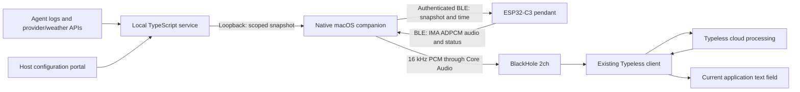

**English** · [简体中文](2026-10-14-ble-companion-mvp.zh_CN.md)

# BLE companion MVP: data synchronization and microphone

- Accepted design: 2026-10-14; implementation authorized and revised: 2026-10-15.
- Status: firmware, native macOS helper and loopback adapter implemented; hardware pairing, sustained streaming and Typeless recognition/insertion remain unverified.
- Scope: existing ESP32-C3, macOS first; no pendant network provisioning.
- Decisions: [ADR 0006](../adr/0006-ble-companion-without-device-networking.md), [ADR 0007](../adr/0007-microphone-bridge-reuses-desktop-dictation.md).

## 1. Architecture



BLE is Bluetooth Low Energy, supported by ESP32-C3. This custom GATT service does not enumerate as a standard Bluetooth headset. The separately installed virtual audio device supplies the microphone endpoint. The pendant stores no recordings. The bridge contains no ASR, model download, clipboard or text-insertion implementation. Typeless owns recognition, AI cleanup, its desktop shortcut, cloud access and subscription.

The app no longer starts Wi-Fi, SoftAP or HTTP tasks. Legacy sources and NVS keys remain for reference/rollback. Local brightness, volume, rest and focus settings stay on the pendant; the service supplies badge, readings, weather and time. Current/built-in assets stay installed; new BLE skin downloads are deferred. Collectors retain their existing schedules, independently of BLE traffic. The helper polls cached snapshots every 60 seconds and honors explicit sync requests; it does not invoke vendor APIs at packet cadence.

## 2. Identity and explicit authorization

The public device ID is the immutable factory eFuse MAC, displayed as `AA:BB:CC:DD:EE:FF`. This is the hardware identity, not a rotating BLE address or CoreBluetooth peripheral UUID. The helper requires an explicit full ID (desktop settings or CLI `--device`) and verifies the read characteristic before authenticating or sending a snapshot.

Each service data directory has a separately persisted random host UUID (`companion-host.json`). The firmware stores up to four associations: host UUID, ASCII display name, and the authenticated BLE peer identity address. A claimed UUID or MAC never substitutes for possession of BLE bond keys. A newly generated service UUID represents a new source and requires confirmation again.

Only one BLE connection and one selected data source are active:

1. On the pendant, enter **Settings → Bluetooth**. New pairing is open for 60 seconds. If already connected, enter that page and press OK to explicitly switch computers: disconnect the old link and defer its host UUID during the window so it cannot repeatedly occupy the single connection slot. If no takeover completes before timeout, the original selected computer can resume.
2. macOS and NimBLE use authenticated LE Secure Connections numeric comparison, MITM protection and persistent bonding. Compare both displays; click OK on the pendant to accept, hold OK to reject. Legacy/Just Works fallback and silent bond replacement are disabled.
3. The hello carries protocol version, host UUID and a display name. An unknown host needs the open window and an available association slot. A known UUID presented by a different BLE peer is rejected.
4. A new source or a returning non-selected computer prompts **Use data from [name]?** on the pendant. OK accepts; hold OK rejects; timeout rejects. Reconnecting the already selected authenticated host resumes without another takeover prompt.
5. Confirmed takeover persists the selected identity and invalidates the previous source's displayed snapshot/badge. A subsequent complete snapshot replaces the source; values are never summed across computers. Focus, XP and local settings are device-owned and remain intact.
6. **Forget Mac** prompts before removing all computer associations and bonds, and clears the source-owned display. It preserves local focus/XP/settings/assets and dormant legacy network data. Remove a stale bond on macOS as well before pairing anew.

The desktop registry uses the composite `(host UUID, factory MAC)` key. Reconnects reuse that entry; another pendant or host cannot inherit it. Snapshots carry both identities in `source`, checked again in firmware before parsing/application. The new NVS cache atomically stores owner and JSON in one blob; reboot accepts it only for the selected host and this device. Legacy Wi-Fi caches are never silently assigned to a BLE host. Storage errors fail closed; startup does not erase NVS to recover space or hide incompatible data.

## 3. Version-1 wire contract

Authoritative implementations: [firmware GATT](../../main/app/app_ble.c), [portable framing/codec](../../main/app/app_ble_protocol.h), [trust decisions](../../main/app/app_ble_trust.c), [Swift protocol](../../companion/macos/Protocol.swift).

UUID base: `57f1000N-ac9d-4b41-8c93-20cc0e04d001`:

| N | Characteristic | Contract |
| --- | --- | --- |
| 0 | Primary service | Discovery |
| 1 | Public identity, read | JSON: `v=1`, factory `device`, `codec=ima320`, `rate=16000` |
| 2 | Authenticated control, read/write/notify | Hello `{v,host,name}`; authorized stop `{v,op:"stop"}` / self-revocation `{v,op:"revoke"}`; status `{v,device,ready,mic,sync,accepted,error}` |
| 3 | Authenticated snapshot write with response | Ordered transaction below, followed by accepted-counter acknowledgement |
| 4 | Audio notifications | One independent 172-byte ADPCM block per notification; authorized subscribed peer only |

All binary integers are little endian. Snapshot begin is `0x01 + u16 length + u32 IEEE CRC32`; data is `0x02 + u16 offset + bytes`; commit is `0x03`. JSON length is 1–4095 bytes, with a reserved NUL. Every chunk must start at the next exact offset. Missing/replayed/out-of-order/oversized/embedded-NUL/CRC-invalid data aborts that transaction without replacing the previous valid snapshot. The schema-1 parser and scoped source must also pass before persistence/publication. The desktop waits for the accepted counter to change, times out and retries on failure, and sizes writes from CoreBluetooth's actual maximum (capped at 244 bytes).

Audio is 16 kHz mono signed PCM at capture, independently encoded as IMA ADPCM: version `u8=1`, stream ID `u32`, sequence `u32`, initial predictor `i16`, index `u8`, then 319 nibbles (low nibble first, final high nibble padded). The first predictor is sample 0; total decoded samples are 320. Frame size is 172 bytes, duration 20 ms, payload rate 8,600 bytes/s before BLE overhead. MTU must fit at least 175 bytes. Missing subscriber, MTU failure or send failure stops capture explicitly; there is no backlog replay after reconnect. Each new stream starts at sequence zero.

## 4. Capture, scheduling and failures

The existing audio worker is now the sole owner of codec wake/format/playback/read/sleep. Microphone requests interrupt playback and enter capture on that same worker, eliminating cross-worker codec races. PCM and encoded packets are bounded one-frame buffers on its fixed stack, plus one 172-byte host-event slot. Notification validation/enqueue runs on the NimBLE host task, checking epoch and authentication without a connection-handle reuse race. A busy slot or notification failure stops capture rather than building an utterance backlog. Reads use the pinned codec driver's 1-second timeout. Capture UI shows starting/streaming, peak level, stopped or error. OK toggles; long OK stops and returns. No producer retains UI object pointers.

During capture, pet animation is static, sleep is inhibited, snapshots are rejected/deferred and the helper coalesces to one pending refresh. Focus/XP continue; victory navigation/audio wait until capture ends. An established idle BLE connection permits backlight timeout but inhibits the old manual light/deep-sleep path, which would destroy the link. Disconnected idle operation retains existing sleep behavior.

The Mac requires an explicitly selected output (default `BlackHole 2ch`), without changing system output defaults. Only one companion process can own audio, preventing two pendants from mixing into the virtual microphone. Initial jitter buffering is 100 ms; at most 12 scheduled blocks (about 240 ms), with one-sample interpolation corrections at queue edges for slow clock drift. A gap, sequence error, output change, underrun, overflow or stall stops delivery and asks the device to stop. Idle/failed streams produce no buffered replay. Normal stop drains the bounded queue. Cloud dictation may already have partial results; cancel/retry in Typeless after a transport failure.

The helper checks generation/active peripheral before handling callbacks and asynchronous service responses, and retains at most 32 stream IDs to reject old-audio replay across resets. Reconnection backs off up to 30 seconds. It reconnects only the explicitly requested factory MAC. Failed host service reads do not change BLE bond ownership; a missing virtual driver leaves data synchronization available without enabling audio subscription.

## 5. Build and run

The desktop package combines the native menu-bar client, local service, Node runtime and production dependencies. Double-click `build/desktop/Passport Companion.app`; end users need neither a terminal nor Node/Swift installed. On first launch, **Companion settings** asks for the full factory MAC from the pendant and an audio output name. It never chooses a discovered device automatically. For voice, separately install BlackHole 2ch and Typeless; this repository does not redistribute their code or install drivers automatically.

The app owns a loopback-only child service on an OS-assigned port, waits for its readiness message, and stops it on Quit. A closed owner pipe also stops the service after an app crash. A per-user ownership lock prevents duplicate packaged instances. Settings, service host UUID, registry, provider configuration and private credentials live under `~/Library/Application Support/Passport Companion/`, outside the app bundle; replacing/moving the app preserves them. **Open configuration**, **Copy configuration password**, and **Open logs** are available in the menu bar. No login item is installed.

The package does not import the development service's `service/.env` or `service/data`, and never embeds them. The old data remains intact; the packaged app's new data directory represents a new host/source and requires pendant confirmation. Stop the old command-line companion before connecting the packaged app to the same pendant. Automatic legacy-data migration is deferred.

Developers need macOS with Swift command-line tools, Node.js 22+ and installed service dependencies to build:

```bash
npm --prefix service ci
./tools/package-companion.sh
node tools/test-companion-package.mjs 'build/desktop/Passport Companion.app'
```

This produces a local ad-hoc-signed package for the build machine's architecture, not a notarized public installer or universal binary. Runtime/native dependencies and their licenses are bundled. The packager fails if the target already exists; move the previous package aside before rebuilding. The smaller development helper and separate launcher remain available:

Use Passport Companion as the discovery/connection entry point. The current firmware advertises flags and the dedicated 128-bit service UUID, without a local-name field or named scan response; its `AI Passport` GAP name is available after connection. Absence from the macOS system Bluetooth list alone does not establish a discovery failure. The companion scans the service UUID and verifies the full factory MAC through the public identity characteristic. An unbound computer must connect while the pendant's 60-second pairing window is open.

```bash
npm --prefix service ci
./tools/build-companion.sh
./tools/run-companion.sh --scan
./tools/run-companion.sh --device AA:BB:CC:DD:EE:FF
```

Read the actual ID from the pendant's Bluetooth screen; the address above is an illustrative placeholder. Open pairing on the pendant before scanning an unbound device. After scanning, stop that process before starting the selected-device session. The launcher builds the helper and service, prepares a private `service/.env` if absent, starts a loopback-only service if needed, and cleans up the service it started on exit. Read the portal password from that private file; existing configuration is preserved. An incompatible service occupying the configured port must be stopped first. The native helper also supports `--service http://127.0.0.1:PORT`, `--audio-output NAME`, `--list-audio` and `--test-audio`. The launcher reads `PORT` from the environment or `service/.env`; scan/audio-test/help modes do not start the service.

Grant macOS Bluetooth permission to the companion and confirm pairing on both displays. Configure badge/providers/city through **Open configuration** in its menu bar. The new `/api/companion` routes accept loopback sockets only and reject browser-origin/fetch-metadata requests; legacy LAN routes remain for compatibility. The service host UUID and registry live under its existing data directory. Provider secrets never cross BLE. Every five seconds, including during capture, the helper checks `/authorization`. Revocation stops audio, requests removal of this computer association and inhibits automatic reconnect; offline enforcement waits for service availability. Portal **Allow pairing again** restores host permission only: restart the helper and confirm on the pendant. Removing an old HTTP token alone does not revoke BLE.

For dictation, select BlackHole 2ch as Typeless input, start microphone mode on the pendant, start Typeless using its desktop shortcut, and speak. End Typeless dictation before stopping the pendant to retain the final syllable. Menu-bar **Stop microphone** is an emergency stop. The helper does not synthesize Typeless shortcuts or promise automatic dictation-session control.

## 6. Rollback and retained data

The annotated local tag `rollback/pre-ble-2026-10-15` points to `eb757d83a277cbb79a2a2ccfa10781e01b875314`. Its annotation records the previously verified full-image hash `3ca74982cb832cf8ec7fd171202f391bda83004fa7b21749381fa36d85f1661c` and matching ELF hash `ca20443dfe34aa4be40f5e2c7c824c50a6f54dc980cf5e40a71e85f77ec220bf`. The exact local archive is under `build/firmware/<full-image-hash>/`. The tag captures source, not a live-device/NVS backup or pending documentation edits. It has not been pushed.

Partition offsets and existing focus/XP/settings/assets keys remain unchanged. New bindings/cache use the separate `ble_app` namespace; NimBLE stores its own bonds. Prefer the verified segmented app update when retaining device data. Do not erase the chip or assume a merged full image preserves NVS. Returning to old firmware restores the old transport; it sees its dormant old network/cache data rather than importing a BLE source. Flashing any image requires explicit approval.

## 7. Decision reversal ledger

| Earlier design | Replacement | Reason and retained boundary |
| --- | --- | --- |
| Shared Wi-Fi and hourly pull | BLE direct link and cached host delivery | Office admission constraint; keep snapshot schema and offline behavior |
| SoftAP/phone/four-field setup and NFC onboarding | Computer pairing with physical confirmation | No pendant network credentials, phone or network switching |
| Reject BLE because it needs a nearby PC | Accept nearby running host | Previous local service also required reachability |
| Device HTTP asset downloads | Retain installed assets; BLE bundle transfer later | Large transfers remain lower priority; retain host transcoding/atomic install requirements |
| WebSocket and own ASR/input bridge | BLE + virtual microphone + existing Typeless | Requested role is a microphone; no embedded ASR or input method |
| Whole-utterance buffer/60-second limit | Fixed-size live packets | No recording storage or duration-dependent allocation |
| USB as primary connection | USB for development | Wireless onboarding is the accepted path |
| 2026-10-14 single bound pair | 2026-10-15 up to four remembered hosts, one confirmed source | Explicit user request for cross-endpoint identity/isolation; no automatic merge |
| 2026-10-14 uncompressed PCM first | 2026-10-15 independent IMA ADPCM blocks first | Lower radio bandwidth and one-packet frames; PCM failure was not measured, ADPCM still needs quality/RF acceptance |
| Separate capture worker awaiting FX stop acknowledgement | One audio owner for FX and capture | Serial codec operations provide ownership directly |
| Retain the historical 64 KiB UI pool and default six controller activities | 2026-10-16: 48 KiB UI pool, two controller activities, reserve BLE tasks before stack startup | First device boot failed BLE/power task startup; native rendering verifies the smaller UI pool, while board heap/audio headroom still needs measurement |
| Render pages directly from the system event callback | Coalesce event flags, apply them on the LVGL task | The settings reproduction overflows the small `sys_evt` stack in string formatting; callbacks must remain bounded and allocation-free |
| Require a source checkout, terminal launcher and installed Node for desktop use | Self-contained macOS app owns the embedded service and runtime | A single launch manages both processes; user state remains outside the replaceable bundle |

The Xiaomi remote project inspired the layering, not protocol/code reuse. Its ATVV/HID/USB-identity workarounds do not apply to this board. This implementation owns its GATT protocol and codec code; no GPL project sources or BlackHole driver are vendored.

## 8. Acceptance and deferred work

Automated gates cover transaction bounds/CRC/order, host spoof rejection/takeover decisions, NVS non-erasure, C/Swift exact decoder interoperability, loopback/browser restrictions, stable device/host registry identity, and existing firmware/service behavior. Run `./tools/validate.sh`, `npm --prefix service run build`, `npm --prefix service test`, and `./tools/build-companion.sh`. Successful compilation does not validate radio, codec or Typeless.

Before calling the MVP hardware-accepted: compare/reject pairing codes, reject an unknown peer outside its window, switch between two computers and two pendants without mixing source caches, power-cycle with source-bound cache, check focus/XP/assets preservation, exercise 100 capture start/stops and at least 30 minutes of audio, test gaps/interference/reconnect/output removal, measure heap/largest internal block/DMA/stack watermarks, capture-to-input latency and battery current. Verify Chinese/English/technical dictation plus first/last syllables and insertion into intended apps. BlackHole/Typeless installation and these device checks remain pending.

Deferred: BLE asset transfer, Windows/Linux companions, remote networking, phone/NFC onboarding, USB audio product mode, HID/Typeless shortcut automation, custom driver redistribution, on-device/local ASR, AI cleanup, and OTA. Local settings are not remotely synchronized in this increment.

## 9. Delivery checkpoint, 2026-10-15

Firmware version `ble-mvp-0.1.0-dev`; source baseline `eb757d8` with uncommitted changes and no push. The complete repository gate passed; service build and 83 tests passed. The native companion compiled, its ad-hoc signature verified, and invalid target/non-loopback URL/missing audio output rejection checks passed. C/Swift codec, framing, sequence/gap/old-stream replay tests passed.

- Full-image SHA-256: `db703a37eb3dd932cd98dba7b4ef75d798d5bceca8b506c612d4ccb723f186db`.
- Matching ELF SHA-256: `a26342a4b885451c9175947efbf03a6905f15f6ae8076e2cec74e6f73eea9b8a`.
- Local archive: `build/firmware/db703a37eb3dd932cd98dba7b4ef75d798d5bceca8b506c612d4ccb723f186db/`; application 1,854,368 / 3,080,192 bytes.
- Desktop application: `build/Passport Companion.app`; validation summary: `build/ble-mvp-validation.json`.
- Build: PASS; Host tests: PASS; Device tests: NOT RUN.
- Unverified: no pendant USB serial candidate detected; pairing, cross-host handoff, physical capture, sustained throughput, BlackHole/Typeless insertion and resource/power measurements remain pending. No firmware was flashed or driver installed automatically.

## 10. Startup failure and repair, 2026-10-16

The Section 9 build was subsequently flashed with explicit approval to the ESP32-C3 application at `0x10000`. The device partition table exactly matched the archive; the erase/write range was `0x10000–0x1D4FFF`, excluding NVS and assets. Hash verification passed. A 25-second startup observation identified the matching ELF prefix `a26342a4b`, initialized display/LVGL/buttons/ES8311/CW2017 and mounted assets, but reported **BLE initialization failure and power-task allocation failure**. No panic was observed. The old BLE initialization returned no failure stage and leaked successful partial allocations, so the precise original BLE failure stage is unproven. Resource exhaustion is the leading hypothesis, not a measured allocation trace.

The repair reclaims 16 KiB of static UI memory by setting `LV_MEM_SIZE=49152`, uses two controller activities (advertising plus one connection) instead of six, and disables unused ATT prepared writes; snapshots already use acknowledged application-framed chunks. Task stack sizes, Secure Connections, numeric confirmation and heap/stack protection remain enabled. `app_ble_startup` reserves the queue and gated worker/host tasks before initializing NimBLE/GATT, releases the gates only on success, and rolls back resources on failure. Failed cleanup blocks a second stack initialization until cleanup succeeds; a queue alone never means the service is ready. Startup and advertising errors now report their stage and internal heap/largest block. A power-task allocation failure also reports heap conditions.

Fault-injection host tests cover every startup allocation/configuration failure, immediate scheduling before configuration, cleanup failure, retry and idempotent success. The native LVGL stress run uses actual application pages/fonts/bundled sprites at 48 KiB, exercising 30 page cycles, six accounts, eight settings and confirmation overlays; peak accounted LVGL allocation was 37,344 bytes (36.5 KiB), with at least a 4 KiB largest free block at each sampled render. Native results do not prove ESP32 RAM, timing, audio or RF behavior. The repaired build requires its own device startup, pairing and streaming acceptance; the failing Section 9 build remains a recorded failed device test.

First repair validation: complete `./tools/validate.sh` PASS and archive re-verification PASS. Full-image SHA-256 `9ff301770b793c33a3cdd2d0fbd1dab555358b0f3d8021b20d71697eeebc2d6d`; matching ELF SHA-256 `91e007b63c3857caf165d3919a8ea3d6c9d430cdb29f36da12da627a7ad72444`. Archive: `build/firmware/9ff301770b793c33a3cdd2d0fbd1dab555358b0f3d8021b20d71697eeebc2d6d/`; application 1,859,680 / 3,080,192 bytes. The ELF confirms the UI static pool is `0xC000` bytes. The partition-table binary is unchanged.

This first repair was approved and flashed application-only, with hash verification and no NVS/assets overlap. A 35-second observation confirmed successful advertising and power-task startup (three heartbeats): idle free heap 25,676 bytes, internal minimum 16,100 bytes, largest free block 9,204 bytes. Minimum unused task stacks were audio 4,728, input 2,736, BLE worker 4,984 and NimBLE host 1,696 bytes. However, one **IDLE task watchdog warning at 5,733 ms** occurred during startup, then execution continued without an observed panic/reboot. The matching ELF decodes the sampled PC/return address to `lv_draw_label_dsc_init`; this does not establish that drawing alone caused starvation. Aggregate radio initialization and first-frame rendering compete on the single core, so hardware acceptance remains incomplete.

A second 15-second startup observation reproduced the IDLE warning at 5,733 ms, this time sampled in `lv_obj_send_event`, while BLE advertising and the power heartbeat again succeeded. The repeat establishes a reproducible startup scheduling problem rather than a single sampled drawing function being proven defective.

The follow-up `ble-mvp-0.1.1-dev` repair initializes BLE before constructing Home/starting its animation timers and adds a 10 ms scheduling break between BLE startup stages, while tasks remain gated. Watchdog timeout, task priorities and safety checks remain unchanged. Snapshot/status restoration still precedes the first UI refresh. Host tests verify the scheduling breaks occur while both BLE tasks remain gated.

The follow-up complete repository gate and archive verification pass. Full-image SHA-256: `b3b7a4ea1a873b94a0757d83fab70c4afb39583a63242c5b44490da522423eb5`; matching ELF: `51c72f8e9003b778b610b5909459f4badd7efb234df9cbcda0755043ef1adc6b`. Archive: `build/firmware/b3b7a4ea1a873b94a0757d83fab70c4afb39583a63242c5b44490da522423eb5/`; application 1,859,712 bytes at `0x10000`, unchanged partition table. After approval it was flashed application-only and hash-verified. BLE advertising started at about 0.83 seconds and application readiness at about 1.9 seconds; no IDLE watchdog warning was observed in the 35-second window. However, the settings reproduction exposed the separate stack fault below. Build: PASS; Host tests: PASS; Device tests: FAIL. Pairing, actual audio and cross-host acceptance remain unverified.

## 11. Settings crash and deferred UI events, 2026-10-16

The user reported that entering Settings reboots the pendant. The matching `51c72f8e9` startup log captured two `sys_evt` stack-protection panics: SP `0x3FCB9680` lies 36 bytes below its lower bound `0x3FCB96A4`. Verified ELF decoding identifies `__ssprint_r` / `_svfprintf_r`. The application's system event callback performed page refreshes, modal construction and formatted label updates directly on this small stack; the stack fault is direct evidence, while a complete caller backtrace was unavailable.

The `ble-mvp-0.1.2-dev` repair makes `on_app_event` record/coalesce fixed event flags only, with a brief critical section and no LVGL lock, allocation, formatting or page construction. A 50 ms LVGL timer takes the batch and applies the UI work under the LVGL task's existing lock/stack. Refresh floods coalesce, victory stays pending, and the last screen transition wins; the consumer also checks current power state. Microphone-deferred victory behavior is retained. No system event or input stack is enlarged. Pure host tests cover event floods, wake/sleep ordering and events posted during a previous batch.

The complete repository gate and archive verification pass. A native test compiles the actual `ui_shell.c` with the real LVGL/pages/fonts/assets, sends 1,000 events through its registered callback, and asserts the callback neither locks LVGL nor changes UI-pool allocation. Deferred timer dispatch, Settings entry and 30 repeated page cycles pass; peak accounted LVGL allocation is 38,232 bytes (37.3 KiB) in the 48 KiB pool. This host test cannot reproduce the ESP32/newlib stack limits.

Tested archive: `build/firmware/664b3b8fa6eea9f48ec12075313cf3e974cb39ef7bb0c4f83cbe1788e66aac58/`; full-image SHA-256 `664b3b8fa6eea9f48ec12075313cf3e974cb39ef7bb0c4f83cbe1788e66aac58`, matching ELF `9b08467eb715aea86cd1c02fb7c7b85f2b16262144d7c7f2a508ccfa76125958`. Application: 1,859,984 bytes at `0x10000`; partition table unchanged. After explicit approval, application-only flashing and hash verification passed. The user confirmed repeated Settings entry/navigation/return no longer reboots. A 45-second serial observation showed one complete application startup, five power heartbeats, successful advertising and no panic, stack fault or watchdog warning. The two leading ROM USB-reset headers correspond to the deliberate post-flash/monitor resets. Build: PASS; Host tests: PASS; Device tests: PASS for startup and the reported Settings reproduction only. BLE pairing, synchronization and physical audio are not accepted by this test.

During those real menu actions the input task's minimum free stack fell to 460 bytes out of 4,096. `ble-mvp-0.1.3-dev` therefore increases only `shell_input` to 5,120 bytes, an additional 1 KiB against the observed idle free heap of 25,664 bytes. Other task stacks, watchdogs, event deferral and the partition layout remain unchanged. This is a measured safety-margin adjustment, not the fix for the separate `sys_evt` overflow.

The 0.1.3 complete gate and archive verification pass. Installed archive: `build/firmware/1f16e594e5bdb6a8c00a91f202fbddfb764f87ed3e59a59119a0c5024637a8b8/`; full-image SHA-256 `1f16e594e5bdb6a8c00a91f202fbddfb764f87ed3e59a59119a0c5024637a8b8`, matching ELF `73bcfb01992e6a3445ec20128d7e5075a69e197a37e978256a46bd9dd096cc8b`, application 1,860,000 bytes at `0x10000`. The user approved this exact update; device identity/partition-table compatibility and application hash were rechecked. Only application sectors `0x10000–0x1D6FFF` were erased/written; NVS and assets stayed outside that range, and flash hash verification passed.

Final 0.1.3 device observation: 45 seconds, matching ELF prefix `73bcfb019`, advertising success, five power heartbeats, no panic/stack fault/watchdog warning. The user confirmed repeated Settings entry/navigation/return remains normal. The input task's measured minimum free stack during this run was 1,532 bytes, idle free heap 24,640 bytes, internal heap minimum 15,064 bytes and largest free block 9,204 bytes. The serial port was closed afterward. Build: PASS; Host tests: PASS; Device tests: PASS for startup and Settings only. Unverified: authenticated BLE pairing, cross-host/device data isolation and synchronization, physical microphone/virtual audio/Typeless insertion, sustained load and power measurements. No commit, push or driver installation was performed.

## 12. First BLE connection and snapshot acceptance, 2026-10-16

The user initially searched the macOS system Bluetooth list. A bounded companion `--scan` session discovered the pendant and read its public factory identity over BLE, confirming the radio discovery/GATT identity path. That scan process was stopped before starting a session explicitly targeting the same factory MAC. The launcher retained existing private configuration and started the local service on `127.0.0.1:3000`.

The user confirmed matching pairing numbers on the Mac and pendant. The companion then reported source confirmation, an authorized connection, and `Snapshot synchronized` after the firmware's accepted counter acknowledged the framed snapshot. This establishes first authenticated pairing/source acceptance and one host-to-pendant snapshot delivery. The companion and its launcher-owned sidecar remain running for use; the menu-bar Quit action exits the companion and the launcher cleans up only the service it started. No new firmware was flashed in this connection test. Diagnostic serial access observed a USB reset, so that observer was closed before completing pairing; connection acceptance relies on the companion acknowledgement and the user's physical confirmation.

Build/Host tests: retain the 0.1.3 PASS above. Device tests: PASS for startup/Settings, BLE discovery/public identity, first authenticated pairing and first single-host snapshot synchronization. Still unverified: reject/mismatch cases, bonded reconnect and ownership revocation, two-computer/two-device handoff/isolation, sustained synchronization/audio and power. The audio output probe reported BlackHole 2ch missing; no driver was installed, and physical microphone-to-Typeless acceptance remains pending. This checkpoint supersedes the pairing/first-snapshot portion of Section 11's earlier unverified list.

## 13. Unified desktop package, 2026-10-16

Implemented a double-click entry point, explicit target/audio settings, persistent private per-user state, an exclusive desktop-instance lock, embedded loopback service startup/readiness and owned-child termination. The bundle contains Node 22, production dependencies/native libraries and license files; source-checkout credentials and data are excluded. The original development launcher remains available. No firmware source, device flash or existing running session was changed by this desktop increment.

Build: PASS (native app, packaged runtime and deep signature verification; complete repository gate also passed). Host tests: PASS (85 service tests, desktop persistence/ownership tests and existing repository host tests). A relocated copy under a path with spaces, reached through macOS's `/tmp` alias, started with only a system PATH and isolated temporary HOME. Its bundled usage CLI ran, the portal and origin guard worked, its host identity survived restart, and owner-pipe EOF stopped the service and closed its port. This test exposed and fixed an entry-point comparison that needed canonical filesystem paths. Local logs: `/tmp/passport-desktop-gate.log`, `/tmp/passport-desktop-service-tests.log`, `/tmp/passport-desktop-relocation-test.log`.

Delivery: `build/desktop/Passport Companion.app` and `build/desktop/Passport Companion-macos-arm64.zip`, local ad-hoc-signed Apple Silicon build. Device tests: NOT RUN for this increment. Unverified: first-launch GUI interaction and the packaged app's physical BLE/voice chain, other macOS machines/versions, sustained operation, and earlier pending hardware cases. The installed pendant remains the Section 11/12 firmware; no new flash is needed for packaging. Before connecting this new data source, quit the old companion and explicitly confirm it on the pendant; automatic development-data migration, login startup and public notarization are deferred.
