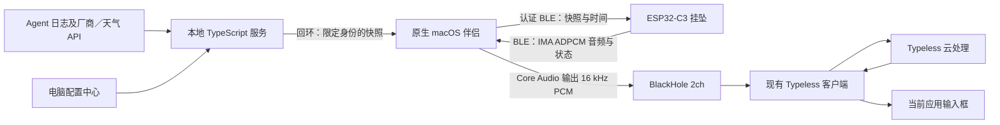

**简体中文** · [English](2026-10-14-ble-companion-mvp.md)

# BLE 伴侣 MVP：数据同步与麦克风

- 设计接受：2026-10-14；实施授权与修订：2026-10-15。
- 状态：固件、原生 macOS 伴侣与回环适配接口已实现；硬件配对、持续传输及 Typeless 识别／输入尚未验收。
- 范围：现有 ESP32-C3，macOS 优先；挂坠不配网。
- 决策：[ADR 0006](../adr/0006-ble-companion-without-device-networking.zh_CN.md)、[ADR 0007](../adr/0007-microphone-bridge-reuses-desktop-dictation.zh_CN.md)。

## 1. 架构



BLE 是 Bluetooth Low Energy，即 ESP32-C3 支持的低功耗蓝牙。这里的自定义 GATT 服务不枚举成标准蓝牙耳机，麦克风入口由单独安装的虚拟音频设备提供。挂坠不存储录音。伴侣不实现 ASR、模型下载、剪贴板或文本注入；识别、AI 整理、桌面快捷键、云服务与订阅由 Typeless 负责。

应用不再启动 Wi-Fi、SoftAP 或 HTTP 任务。旧源码与 NVS 键保留供参考／回退。亮度、音量、作息、专注等设置仍保存在挂坠；电脑服务下发工牌、用量、天气与时间。保留现有／内置素材，新增 BLE 皮肤下载后续实现。采集器维持自身调度，不随 BLE 包频率访问厂商。伴侣每 60 秒读取缓存快照，并响应手动同步请求。

## 2. 身份与明确授权

设备公开 ID 使用不可变的出厂 eFuse MAC，显示为 `AA:BB:CC:DD:EE:FF`。这是硬件身份，不是轮换的 BLE 地址或 CoreBluetooth peripheral UUID。伴侣必须通过桌面设置或 CLI `--device` 指定完整目标，读取身份特征验证一致后才认证或下发快照。

每个服务数据目录独立持久化随机电脑 UUID（`companion-host.json`）。固件最多保存四组关联：电脑 UUID、ASCII 显示名、经过蓝牙认证的对端身份地址。自报 UUID 或 MAC 都不能替代 BLE 绑定密钥。服务重新生成 UUID 表示新数据源，需要重新确认。

同时只允许一条 BLE 连接、一个选中的数据源：

1. 在挂坠进入**设置 → Bluetooth**，开放新配对 60 秒。若当前已有电脑连接，先进入该页，再按 OK 明确切换；旧连接会断开，窗口内旧 host UUID 暂不恢复，避免它反复抢占唯一连接槽。窗口超时未完成接管时，原选中电脑可恢复。
2. macOS 与 NimBLE 使用有 MITM 防护、持久化绑定的 LE Secure Connections 数字比较。核对两端数字；挂坠短按 OK 同意，长按 OK 拒绝。禁用旧配对、Just Works 降级与静默替换绑定。
3. hello 包含协议版本、电脑 UUID 和显示名。陌生电脑必须在开放窗口内且有空余关联槽。已知 UUID 如果来自不同 BLE 身份，拒绝授权。
4. 新数据源或已记住但当前未选中的电脑，需要挂坠显示 **Use data from [name]?**。短按 OK 同意、长按拒绝，超时拒绝。同一选中电脑使用已认证绑定重连时可直接恢复。
5. 确认接管后持久化当前身份，清除上一来源显示的快照／工牌。后续完整快照替换来源，绝不跨电脑累加。番茄、经验和本地设置属于设备，不随来源合并。
6. **Forget Mac** 再次确认后删除所有电脑关联与绑定，清除来源数据的显示；保留番茄／经验／设置／素材及休眠的旧网络数据。重新配对前，macOS 也应移除失效绑定。

桌面注册表使用 `(电脑 UUID, 出厂 MAC)` 复合键。重连复用原记录，其他挂坠或电脑不会继承。快照 `source` 同时包含两端身份，固件解析／应用前再次核对。新 NVS 缓存把 owner 和 JSON 原子存成一个 blob；重启仅接受属于当前选中电脑及本挂坠的缓存。不会把旧 Wi-Fi 缓存默认为 BLE 来源。存储异常时拒绝授权／提交；启动不会为腾空间或掩盖版本不兼容而擦除 NVS。

## 3. 第 1 版线协议

权威实现：[固件 GATT](../../main/app/app_ble.c)、[纯逻辑分包／编解码](../../main/app/app_ble_protocol.h)、[授权判定](../../main/app/app_ble_trust.c)、[Swift 协议](../../companion/macos/Protocol.swift)。

UUID 基址：`57f1000N-ac9d-4b41-8c93-20cc0e04d001`：

| N | 特征 | 契约 |
| --- | --- | --- |
| 0 | 主服务 | 发现 |
| 1 | 公开身份，只读 | JSON：`v=1`、出厂 `device`、`codec=ima320`、`rate=16000` |
| 2 | 认证控制，读／写／通知 | hello `{v,host,name}`；授权停止 `{v,op:"stop"}`／本电脑解除 `{v,op:"revoke"}`；状态 `{v,device,ready,mic,sync,accepted,error}` |
| 3 | 认证快照，带响应写入 | 以下有序事务，通过 accepted 计数变化确认应用 |
| 4 | 音频通知 | 每条通知一个独立的 172 字节 ADPCM 块；仅发送给已授权订阅者 |

二进制整数均为小端。快照 begin 为 `0x01 + u16 length + u32 IEEE CRC32`；data 为 `0x02 + u16 offset + bytes`；commit 为 `0x03`。JSON 长度 1–4095 字节，预留 NUL。每块必须从精确的下一个 offset 开始。缺失、重放、乱序、超长、内嵌 NUL、CRC 错误都会终止本次事务，保留上一份有效快照；schema-1 解析与 source 校验通过后才保存／发布。电脑等待 accepted 计数变化，失败超时后重试，写入长度采用 CoreBluetooth 实际上限并最多 244 字节。

音源为 16 kHz 单声道有符号 PCM，独立编码为 IMA ADPCM：版本 `u8=1`、流 ID `u32`、序号 `u32`、初始预测值 `i16`、index `u8`，然后 319 个半字节（低半字节先行，末尾高半字节填充）。初始预测值就是第 0 个采样，共还原 320 个采样。帧长 172 字节，时长 20 ms，BLE 开销前为 8,600 bytes/s。MTU 至少 175 字节。订阅者消失、MTU 不够或发送失败立即明确停止采集，不在重连后重放积压音频。新流从序号 0 开始。

## 4. 采集、调度与故障

现有音频任务统一拥有 codec 唤醒／格式／播放／录入／休眠。麦克风请求打断播放后，由同一个任务进入采集，消除跨任务重配 codec 的竞争。PCM 和编码包都是固定任务栈上的单帧缓冲，另有一个 172 字节的蓝牙主机事件槽。发送在 NimBLE 主机任务内核对连接代次与认证后入队，避免句柄复用竞争；槽忙或通知失败会停止，不积压整句。读取使用已锁定 codec 驱动的 1 秒超时。麦克风页显示启动／传输、峰值音量、停止或错误；短按 OK 切换，长按 OK 停止并返回。生产者不保存 UI 对象指针。

采集中冻结宠物动画、禁止睡眠，固件拒绝／延后快照，电脑合并成一个待刷新标记。番茄／经验继续推进，胜利跳转和音效等采集结束再执行。空闲 BLE 连接允许背光超时，但阻止会破坏连接的旧手动浅睡／深睡路径；断线空闲沿用原睡眠行为。

Mac 只输出到明确选择的设备（默认 `BlackHole 2ch`），不修改系统默认输出。同一时间仅一个伴侣进程拥有音频，避免多个挂坠混入同一虚拟麦克风。初始抖动缓冲 100 ms，最多排队 12 块（约 240 ms）；队列接近边界时用单采样插值修正缓慢时钟漂移。丢包、序号错误、输出设备改变、欠载、溢出或停滞会停止投递并请求挂坠停止。空闲／失败不重放积压语音，正常停止会排空有界队列。云听写可能已有部分结果，传输失败后应在 Typeless 取消／重试。

伴侣处理回调及异步服务响应前检查连接代次／活动外设，并用最多 32 个流 ID 的记录拒绝断线后旧音频流重放。重连退避最多 30 秒，只重连明确指定的出厂 MAC。服务读取失败不改变 BLE 绑定归属；缺少虚拟驱动时仍能同步数据，但不启用音频订阅。

## 5. 构建与运行

桌面包将原生菜单栏客户端、本地服务、Node 运行时和生产依赖整合在一起。双击 `build/desktop/Passport Companion.app` 即可，使用者无需终端或预装 Node／Swift。首次启动在 **Companion settings** 填写挂坠显示的完整出厂 MAC 和音频输出名，不会自动选择扫描到的设备。语音另需单独安装 BlackHole 2ch 和 Typeless；仓库不分发其代码，也不会自动安装驱动。

应用管理仅回环监听的子服务，由系统分配端口，收到就绪消息后才连接；Quit 时停止服务，应用崩溃导致管道关闭也会触发服务退出。用户级锁防止重复运行桌面包。设置、服务主机 UUID、注册表、厂商配置和私有凭据保存在 `~/Library/Application Support/Passport Companion/`，位于应用包之外，移动／替换应用后继续保留。菜单栏提供 **Open configuration**、**Copy configuration password** 和 **Open logs**，不会安装登录自启项。

打包时不导入或内嵌开发服务的 `service/.env`、`service/data`。旧数据继续保留；桌面包使用新目录，因此属于新主机／数据源，需要挂坠确认。连接同一挂坠前先退出旧命令行伴侣；自动迁移旧数据留待后续。

开发者构建时需要 macOS、Swift 命令行工具、Node.js 22+ 和已安装的服务依赖：

```bash
npm --prefix service ci
./tools/package-companion.sh
node tools/test-companion-package.mjs 'build/desktop/Passport Companion.app'
```

产物为构建机器当前架构的本地 ad-hoc 签名应用，不是已公证的公开安装包或通用二进制。运行时／原生依赖及其许可证包含在包中。目标已存在时打包器会停止，重新打包前先移开旧包。轻量开发伴侣与独立启动脚本继续可用：

通过 Passport Companion 发现和连接设备。当前固件广播仅包含 flags 和专用 128 位服务 UUID，没有 local-name 字段或带名称的扫描响应；`AI Passport` 的 GAP 名称在连接后读取。仅凭 macOS 系统蓝牙列表没有显示，不能认定设备未广播。伴侣按服务 UUID 扫描，再通过公开身份特征校验完整出厂 MAC。未关联的电脑必须在挂坠的 60 秒配对窗口内连接。

```bash
npm --prefix service ci
./tools/build-companion.sh
./tools/run-companion.sh --scan
./tools/run-companion.sh --device AA:BB:CC:DD:EE:FF
```

从挂坠 Bluetooth 页读取真实 ID，上述地址仅为格式示例。扫描陌生设备前先在挂坠开放配对。扫描结束先停止该进程，再运行指定设备的会话。启动器构建伴侣和服务，缺少配置时生成私有的 `service/.env`，必要时启动仅回环监听的服务，退出时清理自己启动的服务。登录密码从该私有文件读取，已有配置保留。配置端口已有不兼容服务时需先停止。原生伴侣另支持 `--service http://127.0.0.1:PORT`、`--audio-output NAME`、`--list-audio`、`--test-audio`；启动器读取环境或 `service/.env` 的 `PORT`；扫描／音频测试／帮助模式不启动服务。

授予伴侣 macOS 蓝牙权限，并在两端确认配对。通过菜单栏 **Open configuration** 配置工牌／厂商／城市。新增 `/api/companion` 路由只接受回环 socket，并拒绝带浏览器 origin／fetch metadata 的请求；保留旧 LAN 接口用于兼容。电脑 UUID 与注册表保存在已有服务数据目录，厂商密钥不会跨 BLE。伴侣每 5 秒通过 `/authorization` 检查吊销，即使麦克风正在传输；发现吊销后停止音频、请求解除本电脑关联并阻止自动重连。离线时待服务恢复后生效。配置中心“允许重新配对”只恢复主机许可，仍须重启伴侣并在挂坠确认；不能仅删除旧 HTTP 令牌就视为已解除蓝牙。

听写时，在 Typeless 选择 BlackHole 2ch 输入，启动挂坠麦克风模式，用桌面快捷键启动 Typeless 后说话。先结束 Typeless 听写，再停挂坠，保留尾音。菜单栏 **Stop microphone** 可紧急停止。伴侣不模拟 Typeless 快捷键，也不承诺自动控制听写会话。

## 6. 回退与数据保留

本地附注 tag `rollback/pre-ble-2026-10-15` 指向 `eb757d83a277cbb79a2a2ccfa10781e01b875314`。注释记录原已验证完整镜像哈希 `3ca74982cb832cf8ec7fd171202f391bda83004fa7b21749381fa36d85f1661c` 及匹配 ELF 哈希 `ca20443dfe34aa4be40f5e2c7c824c50a6f54dc980cf5e40a71e85f77ec220bf`。原精确归档在 `build/firmware/<完整镜像哈希>/`。tag 保存源码，不是设备／NVS 实时备份，也不包括待提交文档改动；尚未推送。

分区偏移及原有番茄／经验／设置／素材键保持不变。新关联／缓存使用独立的 `ble_app` 命名空间，NimBLE 自行保存绑定。保留设备数据时优先采用已验证的分段应用更新，不擦整片，也不假定合并整包保留 NVS。回到旧固件恢复旧传输，读取其休眠的旧网络／缓存数据，不导入 BLE 来源。刷任何镜像都需要明确批准。

## 7. 推翻记录

| 旧设计 | 替代方案 | 原因与保留边界 |
| --- | --- | --- |
| 同网 Wi-Fi、每小时拉取 | BLE 直连、电脑缓存下发 | 办公网准入限制；保留快照 schema 与离线行为 |
| SoftAP／手机／四字段与 NFC 接入 | 电脑配对、设备物理确认 | 无需设备网络凭据、手机或切网 |
| 因依赖附近电脑而否决 BLE | 接受附近运行的主机 | 原本地服务同样要求可达 |
| 设备 HTTP 下载素材 | 保留现有素材，后续 BLE 包传输 | 大文件优先级靠后；保留电脑转码／原子安装要求 |
| WebSocket 与自研 ASR／输入桥 | BLE＋虚拟麦克风＋现有 Typeless | 需求是麦克风角色，不内置 ASR 或输入法 |
| 整句缓存／60 秒上限 | 固定大小的实时包 | 不存录音，内存不随时长增长 |
| USB 主连接 | USB 用于开发 | 无线接入是已接受方向 |
| 2026-10-14 单一绑定对 | 2026-10-15 最多记住四台电脑、一个确认的数据源 | 用户明确要求跨端身份／隔离，不自动混合 |
| 2026-10-14 优先原始 PCM | 2026-10-15 优先独立 IMA ADPCM 块 | 降低带宽并实现单包一帧；未测得 PCM 失败，ADPCM 音质／射频仍待验收 |
| 独立采集任务等待音效停止确认 | 同一个任务拥有音效与采集 | 用串行 codec 操作直接保证所有权 |
| 沿用历史 64 KiB UI 池和控制器默认六个活动实例 | 2026-10-16：48 KiB UI 池、两个控制器活动实例，先预留 BLE 任务再启动协议栈 | 首次真机启动时 BLE／电源任务失败；原生渲染验证较小 UI 池，板上堆／音频余量仍需实测 |
| 在系统事件回调中直接刷新页面 | 只合并事件标志，由 LVGL 任务执行 UI 操作 | 设置页复现时字符串格式化使较小的 `sys_evt` 栈越界；回调须保持有界且不分配内存 |
| 桌面使用要求源码目录、终端启动器和预装 Node | 独立 macOS 应用管理内置服务与运行时 | 一次启动管理两端进程，用户状态保存在可替换的应用包之外 |

小米遥控器项目提供了分层思路，没有复用其协议／代码。ATVV／HID／USB 身份兼容技巧不适用于本板。这里自行实现 GATT 与 codec，没有引入 GPL 项目源码或 BlackHole 驱动。

## 8. 验收与后续范围

自动检查覆盖事务边界／CRC／顺序、电脑冒充拒绝／接管决策、NVS 不擦除、C／Swift 精确解码一致性、回环／浏览器访问限制、设备／电脑注册身份稳定性及既有固件／服务行为。运行 `./tools/validate.sh`、`npm --prefix service run build`、`npm --prefix service test`、`./tools/build-companion.sh`。编译成功不代表射频、codec 或 Typeless 已验证。

硬件验收前需要：配对数字比较／拒绝、窗口外陌生对端拒绝、两台电脑与两个挂坠切换不混缓存、来源缓存重启恢复、番茄／经验／素材保留、100 次采集启停与至少 30 分钟音频、丢包／干扰／重连／输出移除、堆／最大内部块／DMA／栈水位、采集到输入延迟与电流。验证中文／英文／技术词、首尾音及目标应用输入。BlackHole／Typeless 安装与这些设备检查尚待完成。

后续：BLE 素材传输、Windows／Linux、远程联网、手机／NFC、产品 USB 音频、HID／Typeless 快捷键自动化、自研驱动分发、设备端／本地 ASR、AI 整理、OTA。本次不远程同步设备本地设置。

## 9. 2026-10-15 交付检查点

固件版本 `ble-mvp-0.1.0-dev`；源码基线 `eb757d8`，新改动尚未提交／推送。完整仓库验证通过；服务构建与 83 项测试通过；原生伴侣编译、临时签名、非法目标／非回环 URL／缺失音频输出的拒绝检查通过。C／Swift 编解码、分包、序号／丢包／旧流重放测试通过。

- 完整镜像 SHA-256：`db703a37eb3dd932cd98dba7b4ef75d798d5bceca8b506c612d4ccb723f186db`。
- 匹配 ELF SHA-256：`a26342a4b885451c9175947efbf03a6905f15f6ae8076e2cec74e6f73eea9b8a`。
- 本地归档：`build/firmware/db703a37eb3dd932cd98dba7b4ef75d798d5bceca8b506c612d4ccb723f186db/`；应用 1,854,368 / 3,080,192 字节。
- 桌面程序：`build/Passport Companion.app`；验证摘要：`build/ble-mvp-validation.json`。
- Build: PASS；Host tests: PASS；Device tests: NOT RUN。
- Unverified: 未检测到挂坠 USB 串口；配对、跨端切换、实机收音、持续吞吐、BlackHole／Typeless 输入及资源／功耗指标仍待验收。没有刷机或自动安装驱动。

## 10. 2026-10-16 启动失败与修复

第 9 节构建随后经明确授权刷入 ESP32-C3 的 `0x10000` 应用分区。设备分区表与归档完全一致，擦写范围为 `0x10000–0x1D4FFF`，不涉及 NVS 和素材，哈希校验通过。25 秒启动观察匹配 ELF 前缀 `a26342a4b`，显示／LVGL／按键／ES8311／CW2017 初始化及素材挂载完成，但出现 **BLE 初始化失败、电源任务分配失败**，没有观察到 panic。旧 BLE 初始化不报告具体失败阶段，且未回收已经成功分配的部分资源，因此原始 BLE 的精确失败阶段尚未证实；资源耗尽是首要推测，不是已测得的分配轨迹。

修复将 `LV_MEM_SIZE` 设为 `49152`，收回 16 KiB UI 静态内存；控制器由六个活动实例改为两个（广播与单连接），关闭未使用的 ATT 准备写，快照仍使用有响应的应用层分包。任务栈大小、Secure Connections、数字确认及堆／栈保护保持启用。`app_ble_startup` 在 NimBLE／GATT 前预留队列及带启动门禁的工作／协议栈任务，全部成功才放行，失败则回收资源；清理失败时，必须先完成清理才能再次初始化协议栈。队列存在不再等于服务已就绪。启动与广播错误会输出具体阶段、内部堆和最大连续块，电源任务分配失败也会报告内存情况。

主机故障注入覆盖每个启动分配／配置失败、配置前立即调度、清理失败、重试和重复成功调用。原生 LVGL 压力测试使用真实应用页面／字体／内嵌素材，在 48 KiB 池中完成 30 轮切页，覆盖六个账户、八项设置及确认弹窗；LVGL 计入的分配峰值为 37,344 字节（36.5 KiB），每次采样渲染的最大空闲块均至少 4 KiB。原生结果不代表 ESP32 内存、时序、音频或射频验收；修复构建仍需单独验证启动、配对和持续传输，第 9 节构建的失败真机记录继续保留。

第一轮修复验证：完整 `./tools/validate.sh` 通过，归档复核通过。完整镜像 SHA-256 为 `9ff301770b793c33a3cdd2d0fbd1dab555358b0f3d8021b20d71697eeebc2d6d`，匹配 ELF SHA-256 为 `91e007b63c3857caf165d3919a8ea3d6c9d430cdb29f36da12da627a7ad72444`。归档：`build/firmware/9ff301770b793c33a3cdd2d0fbd1dab555358b0f3d8021b20d71697eeebc2d6d/`；应用 1,859,680 / 3,080,192 字节。ELF 确认 UI 静态池为 `0xC000` 字节，分区表二进制保持一致。

第一轮修复已获批准并仅刷入应用，哈希校验通过，不涉及 NVS／素材分区。35 秒观察确认广播与电源任务启动成功（三次心跳）：待机空闲堆 25,676 字节，内部堆历史最低 16,100 字节，最大空闲块 9,204 字节；音频／输入／BLE 工作／NimBLE 任务最少剩余栈分别为 4,728／2,736／4,984／1,696 字节。但启动时在 5,733 ms 出现一次 **IDLE 任务看门狗告警**，之后继续运行，没有观察到 panic／重启。匹配 ELF 将采样 PC／返回地址定位到 `lv_draw_label_dsc_init`，不能据此认定只有绘制导致了饥饿；单核上蓝牙初始化与首帧渲染的累积工作竞争 CPU，因此尚未完成硬件验收。

第二次 15 秒启动观察又在 5,733 ms 复现 IDLE 告警，这次采样位置为 `lv_obj_send_event`，而 BLE 广播及电源心跳仍然成功。这确认了可复现的启动调度问题，不能据单次采样将某个绘制函数认定为缺陷根因。

后续 `ble-mvp-0.1.1-dev` 修复在构建主屏／启动动画定时器之前初始化 BLE，并在 BLE 启动阶段之间增加 10 ms 调度间隔，此时两个 BLE 任务仍受启动门禁约束。看门狗超时、任务优先级与安全检查保持不变，快照／状态恢复仍先于首次 UI 刷新。主机测试验证调度间隔发生时两个 BLE 任务尚未放行。

后续完整仓库验证及归档复核通过。完整镜像 SHA-256：`b3b7a4ea1a873b94a0757d83fab70c4afb39583a63242c5b44490da522423eb5`；匹配 ELF：`51c72f8e9003b778b610b5909459f4badd7efb234df9cbcda0755043ef1adc6b`。归档：`build/firmware/b3b7a4ea1a873b94a0757d83fab70c4afb39583a63242c5b44490da522423eb5/`；应用 1,859,712 字节，偏移 `0x10000`，分区表保持不变。获批后仅刷入应用，哈希校验通过；BLE 广播约 0.83 秒启动，应用约 1.9 秒就绪，35 秒窗口内未观察到 IDLE 看门狗告警，但设置页复现暴露了下述独立栈故障。Build: PASS；Host tests: PASS；Device tests: FAIL。配对、真实音频及跨端切换验收仍未完成。

## 11. 2026-10-16 设置页崩溃与 UI 事件延后处理

用户报告进入设置即重启。匹配 `51c72f8e9` 的启动日志捕获两次 `sys_evt` 栈保护 panic：SP `0x3FCB9680` 比栈下界 `0x3FCB96A4` 低 36 字节。已验证 ELF 将位置定位到 `__ssprint_r`／`_svfprintf_r`。应用系统事件回调直接在较小的栈上刷新页面、构建弹窗及格式化标签；栈越界是直接证据，但未获得完整调用回溯。

`ble-mvp-0.1.2-dev` 修复将 `on_app_event` 改为只在短临界区内记录／合并固定事件标志，不获取 LVGL 锁、不分配内存、不格式化或构建页面。50 ms 的 LVGL 定时器取走批次，在 LVGL 任务既有锁和栈上处理 UI。重复刷新合并，胜利事件保留，息屏／唤醒保留最后一次状态，执行时也检查当前电源状态；继续保留麦克风期间延后胜利的行为。不扩大系统事件或输入任务栈。纯主机测试覆盖事件洪峰、息屏／唤醒顺序及处理前一批时到达的新事件。

完整仓库验证及归档复核通过。原生测试编译实际 `ui_shell.c` 及真实 LVGL／页面／字体／素材，向注册的事件回调发送 1,000 次事件，断言回调不获取 LVGL 锁，也不改变 UI 池分配。定时器延后处理、进入设置及 30 轮切页通过；48 KiB 池中的 LVGL 计入分配峰值为 38,232 字节（37.3 KiB）。主机测试不能复现 ESP32／newlib 的栈限制。

已测试归档：`build/firmware/664b3b8fa6eea9f48ec12075313cf3e974cb39ef7bb0c4f83cbe1788e66aac58/`；完整镜像 SHA-256 `664b3b8fa6eea9f48ec12075313cf3e974cb39ef7bb0c4f83cbe1788e66aac58`，匹配 ELF `9b08467eb715aea86cd1c02fb7c7b85f2b16262144d7c7f2a508ccfa76125958`。应用 1,859,984 字节，偏移 `0x10000`，分区表保持不变。经明确批准，仅刷入应用并通过哈希校验。用户确认重复进入设置／切换／返回不再重启；45 秒串口观察显示一次完整应用启动、五次电源心跳、广播成功，没有 panic、栈保护或看门狗告警。开头两条 ROM USB 复位头对应刷写后／监测时的主动复位。Build: PASS；Host tests: PASS；Device tests: PASS（仅启动及本次设置页复现）。此测试不代表 BLE 配对、同步或真实音频已经验收。

上述真实菜单操作中，输入任务在 4,096 字节栈里最少仅剩 460 字节。因此 `ble-mvp-0.1.3-dev` 只将 `shell_input` 调整为 5,120 字节，新增 1 KiB；作为预算参考，实测待机空闲堆为 25,664 字节。其他任务栈、看门狗、事件延后处理和分区布局保持不变。这是基于实测的余量调整，不替代独立的 `sys_evt` 越界修复。

0.1.3 完整验证及归档复核通过。已安装归档：`build/firmware/1f16e594e5bdb6a8c00a91f202fbddfb764f87ed3e59a59119a0c5024637a8b8/`；完整镜像 SHA-256 `1f16e594e5bdb6a8c00a91f202fbddfb764f87ed3e59a59119a0c5024637a8b8`，匹配 ELF `73bcfb01992e6a3445ec20128d7e5075a69e197a37e978256a46bd9dd096cc8b`，应用 1,860,000 字节，偏移 `0x10000`。用户明确批准此镜像后，再次核对设备身份、分区兼容性和应用哈希；仅擦写应用扇区 `0x10000–0x1D6FFF`，NVS 和素材不在此范围，刷写哈希校验通过。

最终 0.1.3 真机观察：45 秒，ELF 前缀匹配 `73bcfb019`，广播成功、五次电源心跳，没有 panic／栈保护／看门狗告警。用户确认重复进入设置／切换／返回仍然正常。本次操作中输入任务最少剩余栈为 1,532 字节，待机空闲堆 24,640 字节，内部堆历史最低 15,064 字节，最大空闲块 9,204 字节，观察结束后已释放串口。Build: PASS；Host tests: PASS；Device tests: PASS（仅启动与设置）。Unverified: 认证 BLE 配对、跨电脑／设备数据隔离与同步、实机麦克风／虚拟音频／Typeless 输入、持续负载及功耗测量。未提交、推送或安装驱动。

## 12. 2026-10-16 首次 BLE 连接与快照验收

用户起初在 macOS 系统蓝牙列表搜索。限时伴侣 `--scan` 会话发现挂坠，并通过 BLE 读取公开出厂身份，确认无线发现／GATT 身份读取链路。停止扫描进程后，再启动明确指定同一出厂 MAC 的正式会话。启动器保留现有私有配置，在 `127.0.0.1:3000` 启动本地服务。

用户在 Mac 和挂坠核对配对数字并确认，伴侣随后报告来源确认、授权连接，以及固件 accepted 计数确认分包快照后的 `Snapshot synchronized`。这验证了首次认证配对／来源接纳及单电脑向挂坠交付一份快照。伴侣及本次启动器拥有的本地服务保持运行，供继续使用；菜单栏 Quit 退出伴侣后，启动器只清理自己启动的服务。本次连接测试没有刷入新固件。诊断串口访问期间观察到 USB 复位，故在完成配对前关闭了观察器；连接验收依据伴侣确认和用户实体确认。

Build／Host tests：沿用上述 0.1.3 PASS。Device tests：启动／设置、BLE 发现／公开身份、首次认证配对及首次单电脑快照同步 PASS。仍未验证：拒绝／数字不匹配、绑定重连及归属吊销、两台电脑／两个挂坠切换隔离、持续同步／音频及功耗。音频输出探测提示缺少 BlackHole 2ch，未安装驱动，实机麦克风到 Typeless 的验收仍待完成。此检查点更新第 11 节先前未验证列表中的配对／首次快照部分。

## 13. 2026-10-16 统一桌面包

已实现双击启动、明确指定目标／音频输出、用户私有状态持久化、桌面单实例锁、内置回环服务启动／就绪检测及所属子进程退出清理。包内包含 Node 22、生产依赖／原生库及许可证，不包含源码目录的凭据或数据。原开发启动器继续可用。本次桌面改动未修改固件源码、刷写设备或切换当前正在运行的会话。

Build：PASS（原生应用、内置运行时、深度签名验证及完整仓库检查）。Host tests：PASS（85 项服务测试、桌面持久化／实例锁及仓库现有宿主测试）。将应用移到包含空格、经 macOS `/tmp` 别名访问的目录，使用系统 PATH 和隔离的临时 HOME 启动：内置用量 CLI、配置页面和 origin 限制正常，服务重启后主机身份不变，所属管道 EOF 能停止服务并关闭端口。该检查发现并修复了入口路径比较必须使用规范化真实路径的问题。本地日志：`/tmp/passport-desktop-gate.log`、`/tmp/passport-desktop-service-tests.log`、`/tmp/passport-desktop-relocation-test.log`。

产物：`build/desktop/Passport Companion.app`、`build/desktop/Passport Companion-macos-arm64.zip`，Apple Silicon 本地 ad-hoc 签名版本。Device tests：本次 NOT RUN。未验证：首次启动图形交互、桌面包的实体 BLE／语音链路、其他 Mac／系统版本、持续运行及此前未完成的硬件场景。挂坠仍运行第 11／12 节已安装的固件，打包无需重新刷写。连接这个新数据源前，先退出旧伴侣并在挂坠明确确认；自动迁移开发数据、登录自启和公开公证留待后续。
